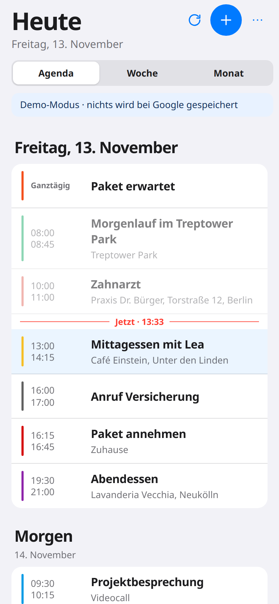

# Kalender

Persönliche Kalender-App für einen Menschen. Sie läuft komplett im Browser, lässt sich auf dem iPhone zum Home-Bildschirm hinzufügen und liest und schreibt Termine im **primären Google-Kalender**. Was ein Assistent dort über die Google-Calendar-API anlegt, erscheint hier nach dem nächsten Öffnen, Ziehen oder Zurückkehren in die App.

Zeiten und Daten sind **deutsch** (`de-DE`) und gelten für **Europe/Berlin**. Die Woche beginnt am Montag, der Sonntag ist rot markiert.



## Funktionen

- Ansichten: **Agenda** (Heute und die nächsten 60 Tage), **Woche** (Streifen plus Tagesplan), **Monat**
- Termin antippen für die Details; anlegen, bearbeiten und löschen (Titel, Datum, Beginn/Ende oder ganztägig, Ort, Notizen)
- Ziehen zum Aktualisieren, Knopf „Aktualisieren“, und automatisches Nachladen, wenn die App wieder in den Vordergrund kommt
- Anmeldung mit Google im Browser (Google Identity Services, Token-Flow, Scope `https://www.googleapis.com/auth/calendar`)
- Demo-Modus mit Beispieldaten, ganz ohne Anmeldung
- Dunkles Design folgt dem System, umschaltbar auf Hell oder Dunkel
- Progressive Web App: Manifest, Icons, Apple-Touch-Icon, Service Worker. Offline bleibt die Hülle da, und die zuletzt geladenen Termine bleiben sichtbar

Es gibt keinen eigenen Server. Das Zugriffstoken bleibt im Browser dieses Geräts.

## Demo ansehen

Ohne Client-ID auf **Demo ansehen** tippen. Die Beispiele liegen nur auf diesem Gerät und werden nicht zu Google geschickt. Eigene Demo-Termine bleiben erhalten, die Beispiele richten sich jeden Tag neu aus. Im Menü gibt es **Beispieldaten zurücksetzen**.

## Lokal starten

Voraussetzung: Node.js 20 oder neuer.

```bash
npm install
npm run dev
```

Die App liegt unter [http://127.0.0.1:4317](http://127.0.0.1:4317). Der Port ist fest, weil Google den Ursprung **inklusive Port** braucht.

```bash
npm test          # Datum, Zeitzone, API-Körper
npm run build     # statische Dateien nach dist/
npm run preview   # dist/ auf demselben Port
```

## Google Cloud einrichten

Die Client-ID trägst du selbst ein. Sie ist kein Geheimnis (sie steht im Browser), ein **Client-Secret gehört nicht** in dieses Projekt. Die Absicherung ist die Liste der erlaubten JavaScript-Ursprünge.

1. Öffne die [Google Cloud Console](https://console.cloud.google.com/) und lege ein Projekt an, zum Beispiel „Kalender“.
2. **APIs und Dienste → Bibliothek**, suche **Google Calendar API**, und aktiviere sie.
3. **APIs und Dienste → OAuth-Zustimmungsbildschirm**.
   - Nutzertyp: **Extern** (bei einem privaten Gmail-Konto). In einer Google-Workspace-Organisation kannst du **Intern** wählen.
   - App-Name: `Kalender`
   - E-Mail für den Nutzersupport und die Entwicklerkontakt: deine Adresse
   - Scope hinzufügen: `https://www.googleapis.com/auth/calendar`  
     (in der Liste etwa: „Alle Kalender anzeigen, bearbeiten, freigeben und dauerhaft löschen, auf die du mit Google Kalender zugreifen kannst“)
   - Unter **Testnutzer** die Gmail-Adresse eintragen, mit der du dich anmeldest. Im Status **Testen** kommt sonst niemand durch die Anmeldung, auch du nicht.
4. Lass die App im Status **Testen**. Der Kalender-Scope gilt als sensibel. Eine Veröffentlichung würde eine Prüfung durch Google verlangen. Für dich allein reicht der Teststatus.
5. **APIs und Dienste → Anmeldedaten → Anmeldedaten erstellen → OAuth-Client-ID**.
   - Anwendungstyp: **Webanwendung**
   - Name: `Kalender Web`
   - **Autorisierte JavaScript-Ursprünge** (nur die Herkunft, kein Pfad, kein Schrägstrich am Ende):
     - `http://localhost:4317`
     - `http://127.0.0.1:4317`
     - `https://DEINNAME.github.io` wenn die App auf GitHub Pages liegt
   - **Autorisierte Weiterleitungs-URIs**, damit die Anmeldung auf dem iPhone zurückfindet. Trag die genaue Adresse der Seite ein, zum Beispiel:
     - `http://localhost:4317/`
     - `http://127.0.0.1:4317/`
     - `https://DEINNAME.github.io/` oder `https://DEINNAME.github.io/REPO/`
   - Wenn Google später `redirect_uri_mismatch` meldet, steht in der Fehlermeldung die exakte URI. Die kopierst du in dieses Feld.
6. Erstellen. Die angezeigte **Client-ID** endet auf `.apps.googleusercontent.com`. Das Secret ignorierst du.

`http://localhost:4317` und `http://127.0.0.1:4317` sind für Google zwei verschiedene Ursprünge. Trag beide ein, wenn du beide Adressen benutzt.

Bei einer Projekt-Seite auf GitHub Pages (`https://name.github.io/kalender/`) ist der JavaScript-Ursprung trotzdem nur `https://name.github.io`, ohne den Ordnernamen.

## Client-ID eintragen

In [`public/config.js`](public/config.js). Nach dem Build liegt dieselbe Datei als `config.js` neben `index.html`:

```js
window.KALENDER_CONFIG = {
  googleClientId: "1234567890-abc123xyz.apps.googleusercontent.com",
};
```

Das ist die einzige Einstellung. Leer lassen heißt: nur Demo. Nach dem Eintragen die Seite neu laden. Die Datei wird nicht in das JavaScript-Bündel gepackt, du kannst sie auf dem Server austauschen, ohne neu zu bauen.

Beim ersten Anmelden zeigt Google oft „Google hat diese App nicht überprüft“. Das ist im Teststatus normal. Tippe auf **Erweitert** und dann **Weiter zu Kalender (unsicher)**. Das geht nur mit dem Konto, das als Testnutzer eingetragen ist.

Die Anmeldung öffnet ein Google-Fenster. Am Rechner ist das ein Pop-up (Pop-ups für die Seite erlauben). Auf dem iPhone wechselt die Seite zu Google und kommt zurück. Das Token gilt ungefähr eine Stunde, danach tippst du erneut auf **Anmelden**. Ein Refresh-Token gibt es in diesem Ablauf nicht, weil kein Server eines verwahren könnte.

## Auf GitHub Pages veröffentlichen

Die gebaute App ist statisch (`dist/`). Relative Pfade funktionieren sowohl unter `https://name.github.io/` als auch unter `https://name.github.io/repo/`.

In diesem Repo liegt `.github/workflows/pages.yml`. So geht’s:

1. Das Repo auf GitHub bringen (öffentlich, oder privates Repo mit GitHub Pages).
2. **Settings → Pages → Build and deployment → Source: GitHub Actions.**
3. Den Workflow auf `main` laufen lassen, oder unter **Actions** manuell starten.
4. Die Seiten-URL aus dem Workflow oder aus den Pages-Einstellungen kopieren.
5. Diese Herkunft und die genaue Seiten-URL in der Google-Cloud-Console nachtragen (siehe oben), `config.js` in `public/config.js` mit der Client-ID füllen, und noch einmal bauen und ausliefern.

Ohne Actions: `npm run build` und den **Inhalt** von `dist/` hochladen. Eine Datei namens `.nojekyll` liegt schon dabei, damit GitHub Pages nichts ausfiltert.

## Auf den iPhone-Home-Bildschirm

1. Die veröffentlichte Adresse in **Safari** öffnen (nicht als bloßen Lesezeichen-Link aus einer anderen App).
2. Teilen-Knopf, dann **Zum Home-Bildschirm**.
3. Name **Kalender** lassen, hinzufügen.
4. Die App vom neuen Icon starten. Sie öffnet ohne Safari-Leiste.
5. Einmal mit Google anmelden.

iOS trennt den Speicher der Home-Bildschirm-App oft von Safari. Wenn die Anmeldung in Safari landet statt in der App, öffne die Home-Bildschirm-App und melde dich dort noch einmal an. Danach bleibt das Token in der App, bis es abläuft.

Beim ersten Start einmal online sein, damit der Service Worker die Hülle speichert. Danach öffnet sich die App auch ohne Netz und zeigt die zuletzt geladenen Termine. Speichern und Löschen im Google-Modus braucht eine Verbindung. In der Demo geht das auch offline.

## Assistent

Die App spricht denselben Kalender an wie ein Assistent, der die Calendar API nutzt: den Kalender `primary` des angemeldeten Kontos. Neue Termine von dort sind nach **Aktualisieren**, nach Ziehen nach unten, oder beim Zurückkehren in die App sichtbar (frühestens alle 15 Sekunden, damit nicht bei jedem Blick ein Request rausgeht).

Beim Bearbeiten bleibt der übrige Termin erhalten, also zum Beispiel Teilnehmer und Erinnerungen, die der Assistent gesetzt hat. Geändert werden Titel, Ort, Notizen sowie Beginn und Ende.

## Fehlerbehebung

| Meldung | Was tun |
| --- | --- |
| `redirect_uri_mismatch` oder Ursprung nicht erlaubt | Die in der Google-Meldung genannte URI bzw. den Ursprung exakt eintragen. Port und `localhost` gegen `127.0.0.1` beachten. |
| Zugriff verweigert (403) | Calendar API im Projekt aktiv? Dein Konto unter Testnutzer? Scope `calendar` im Zustimmungsbildschirm? |
| „App nicht überprüft“ | Im Teststatus **Erweitert → Weiter** tippen. Nicht veröffentlichen, solange du keine Prüfung willst. |
| Pop-up blockiert | Pop-ups für die Seite erlauben und erneut auf **Mit Google anmelden** tippen. |
| Anmeldung abgelaufen | Erneut anmelden. Das Zugangstoken hält etwa eine Stunde. |
| Termine fehlen, die der Assistent gerade angelegt hat | Nach unten ziehen oder die App kurz verlassen und wieder öffnen. |

## Technik

- Vite, ohne Framework. Der Build ist statisches HTML, CSS und JavaScript.
- Google Identity Services (`google.accounts.oauth2.initTokenClient`) und die REST-API `https://www.googleapis.com/calendar/v3/calendars/primary/events`
- Service Worker `public/sw.js`. Beim Build werden die echten Dateinamen aus `dist/` in die Vorab-Liste geschrieben.
- Termine offline: `localStorage`, Schlüssel `kalender.v1.cache` und `kalender.v1.demo`

## Was du selbst tun musst

- [ ] Google-Cloud-Projekt anlegen und die Calendar API aktivieren
- [ ] OAuth-Zustimmungsbildschirm auf **Testen** lassen und dich als Testnutzer eintragen
- [ ] OAuth-Client-ID vom Typ **Webanwendung** anlegen, JavaScript-Ursprünge und Weiterleitungs-URIs setzen
- [ ] Die Client-ID in `public/config.js` eintragen
- [ ] Die App bauen und ausliefern (GitHub Pages oder ein anderer statischer Host)
- [ ] Dieselbe Herkunft in der Cloud Console erlauben, falls du noch nicht lokal bleibst
- [ ] In Safari **Zum Home-Bildschirm** wählen und dich in der App anmelden

Bis die Client-ID steht, zeigt **Demo ansehen** die Oberfläche mit Beispieldaten.
